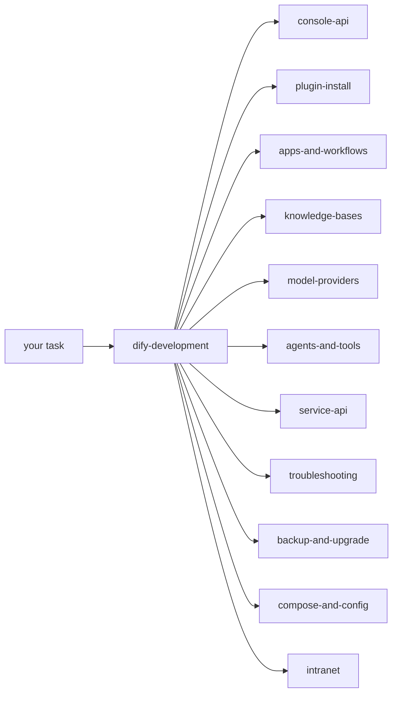
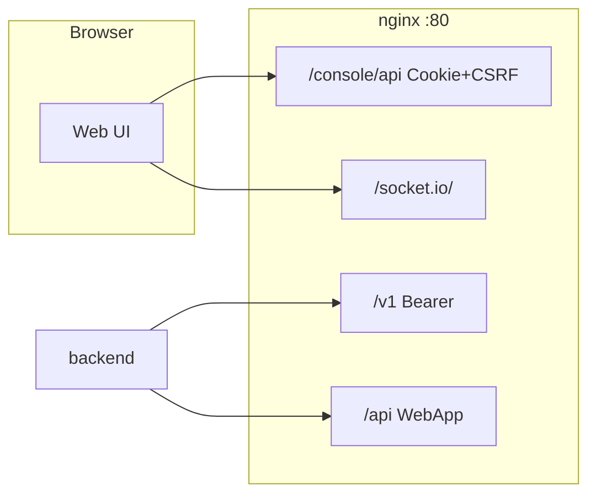

# Dify Operating Skills

English · [简体中文](README.zh-CN.md)

[](https://github.com/langgenius/dify)
[](https://github.com/kabishou11/dify-skills/releases)
[](LICENSE)
[](https://agentskills.io)

Maintainer: [kabishou11](https://github.com/kabishou11) (Zhu Lei)

These [Agent Skills](https://agentskills.io) (`SKILL.md`) operate self-hosted **[Dify](https://github.com/langgenius/dify) Community 1.17**. This tree targets **1.17.1**. They record real HTTP, auth, payloads, and failure modes. They are runbooks for coding agents: the assistant follows the runbook and does not invent routes. They are **not** a substitute for in-app [workspace Skills](https://docs.dify.ai/en/self-host/use-dify/build/skills).

Zips in [`dist/`](dist/) can be **Imported** on the Dify Skills page as drafts, then published. [`v1.17.1`](https://github.com/kabishou11/dify-skills/releases/tag/v1.17.1) is the frozen release for Dify 1.17.1. `main` keeps tracking the latest Dify. A pre-release such as `dify-<ver>-skills-preview` only ships import zips. It is not a freeze.

Official docs: [langgenius/dify](https://github.com/langgenius/dify) · [Skills](https://docs.dify.ai/en/self-host/use-dify/build/skills)

---

## What this is

This repository is an operations runbook for coding assistants. It is not the in-app workspace Skills that a Dify Agent uses in the console. Console Skills are imported and published on the Skills page. These files are `skills/<name>/SKILL.md`. After they are copied into an Agent Skills directory, the assistant loads a skill when its `description` matches. The same folders can be zipped (`SKILL.md` at the archive root) and imported into the console if you want the same checklist inside a Dify Agent. The Agent still needs HTTP or code tools to run the requests.

Start at [dify-development](skills/dify-development/SKILL.md). The assistant preloads only `name` and `description`, and reads the body only after a match.



---

## Problem map

On a self-hosted Dify, failures usually come from the URL prefix, auth, compose injection, canvas DSL, or the Service API `user` scope. The button you clicked is rarely the cause.

| Symptom | Why | Skill |
| --- | --- | --- |
| Login returns `401 Invalid encrypted data` | The password must be **Base64**, not RSA or plaintext | [dify-console-api](skills/dify-console-api/SKILL.md) |
| `401 CSRF`, or it fails again after an hour | The session cookie is missing `X-CSRF-Token` (**GET needs it too**), or the session has expired | [dify-console-api](skills/dify-console-api/SKILL.md) |
| The home page returns 307 | On 1.17 an unauthenticated visit redirects to `/signin`. The install is not broken | [dify-console-api](skills/dify-console-api/SKILL.md) |
| Web SSR: "Server console API URL is not configured" | `web` is missing `SERVER_CONSOLE_API_URL=http://api:5001` | [dify-compose-and-config](skills/dify-compose-and-config/SKILL.md) |
| nginx 502 `host not found in upstream api_websocket` | nginx was reloaded while the websocket service was stopped | [dify-troubleshooting](skills/dify-troubleshooting/SKILL.md) |
| `GET /apps` is missing an Agent | Agent Studio is `GET /agent` | [dify-console-api](skills/dify-console-api/SKILL.md) |
| The canvas changed, but the demo still runs the old graph | `/v1` runs the **published** graph | [dify-apps-and-workflows](skills/dify-apps-and-workflows/SKILL.md) |
| A text-PDF app still has OCR on the canvas | The text app and the OCR app must be two separate apps | [dify-apps-and-workflows](skills/dify-apps-and-workflows/SKILL.md) |
| `.env` changed, but the container does not show it | The running process is what counts. Official 1.17 uses `env_file`. A customized compose often **lists** `environment:` or bind-mounts nginx and squid | [dify-compose-and-config](skills/dify-compose-and-config/SKILL.md) |
| A new box needs to be "tuned to the best" | Tune platform compose, timeouts, uploads, SSRF, and workers. That is **not** an import of custom tools | [dify-development](skills/dify-development/SKILL.md) section 「新环境：Dify 平台基础配置」 |
| A long workflow is killed at 6 minutes | `GUNICORN_TIMEOUT` is still **360**, or nginx is still 3600s | [dify-compose-and-config](skills/dify-compose-and-config/SKILL.md) |
| Celery saturates the CPU and models slow down | `CELERY_AUTO_SCALE` was not given `MAX_WORKERS`, so it scaled to nproc | [dify-compose-and-config](skills/dify-compose-and-config/SKILL.md) |
| PDF upload returns 413 | nginx `client_max_body_size` is smaller than Dify `UPLOAD_*` | [dify-compose-and-config](skills/dify-compose-and-config/SKILL.md) |
| nginx returns `502` after the api container is recreated | The upstream IP is cached. Run `nginx -s reload` | [dify-troubleshooting](skills/dify-troubleshooting/SKILL.md) |
| The canvas stays on 「同步数据中」 (syncing data) | Since 1.16 the canvas uses Socket.IO `/socket.io/`. `NEXT_PUBLIC_SOCKET_URL` must be reachable from the browser | [dify-troubleshooting](skills/dify-troubleshooting/SKILL.md) |
| `POST .../workflows/draft` returns 400 `environment_variables extra_forbidden` | On 1.17, graph sync no longer accepts a top-level env list | [dify-apps-and-workflows](skills/dify-apps-and-workflows/SKILL.md) |
| React error #130 | A DSL node is missing the top-level `type: "custom"` | [dify-apps-and-workflows](skills/dify-apps-and-workflows/SKILL.md) |
| `Invalid upload file` | The `/v1` upload and the run must use the same API key and the same stable `user` | [dify-service-api](skills/dify-service-api/SKILL.md) |
| External knowledge returns 404, or every hit is filtered out | The RAGFlow endpoint must include `/dify`. That path has no rerank, so turn the score threshold off | [dify-knowledge-bases](skills/dify-knowledge-bases/SKILL.md) |
| Plugin uv exits with `exit status 1` | The container has no outbound network. Use a host `.difypkg` and a local PEP 503 index | [dify-plugin-install](skills/dify-plugin-install/SKILL.md) |
| The plugin list shows a name, but the plugin still cannot be used | Trust the daemon, and require **local runtime ready** | [dify-plugin-install](skills/dify-plugin-install/SKILL.md) |
| A tool returns `Unknown error` | `tool_name` must be the OpenAPI `operationId`, not the display name | [dify-agents-and-tools](skills/dify-agents-and-tools/SKILL.md) |
| MinerU is dragged onto every graph, or OCR comes back empty | Build one reusable workflow and publish it as a tool. The plugin does not poll the async `/file_parse` | [dify-agents-and-tools](skills/dify-agents-and-tools/SKILL.md) |
| Webhook 404, or the schedule never runs | The public path is `/triggers/webhook/{id}`. Schedules depend on the worker_beat poller | [dify-apps-and-workflows](skills/dify-apps-and-workflows/SKILL.md) |
| Publish fails after a schedule node is added on a file `start` | `start` and a Trigger cannot share one graph. Split parsing and the daily scan into two apps | [dify-apps-and-workflows](skills/dify-apps-and-workflows/SKILL.md) |
| `/rbac` or `/billing` returns 403 | Community edition feature gates. CSRF is not the problem | [dify-development](skills/dify-development/SKILL.md) |
| Intranet HTTP or RAGFlow returns 502 | Squid SSRF. Add the intranet host to `NO_PROXY`. `SSRF_PROXY_ALLOW_PRIVATE_IPS` is a CIDR list, not `true` | [dify-intranet](skills/dify-intranet/SKILL.md) |
| `.env` changed, but the canvas Loop cap does not | On 1.17, recreate **web**. Runtime caps live on the api as `WORKFLOW_MAX_*` | [dify-compose-and-config](skills/dify-compose-and-config/SKILL.md) |
| Invitation mail is never sent | Use Dify's own `MAIL_TYPE=smtp`, not the email plugin | [dify-compose-and-config](skills/dify-compose-and-config/SKILL.md) |
| A code node is killed at 15 seconds | The limit is `SANDBOX_WORKER_TIMEOUT`, not "sleep ≤ 2s" | [dify-apps-and-workflows](skills/dify-apps-and-workflows/SKILL.md) |
| Knowledge-base hit-testing returns nothing | External knowledge needs `/dify`. Rerank needs four fields. Turn `score_threshold` off | [dify-knowledge-bases](skills/dify-knowledge-bases/SKILL.md) |

---

## Import into Dify

To put a checklist inside a Dify Agent, zip each `skills/<name>/` so that **`SKILL.md` is at the archive root**. On the Dify 1.17 **Skills** page, **Import** a `.zip` or `.skill` (default 50 MB, `UPLOAD_SKILL_FILE_SIZE_LIMIT`). The import lands as a **draft**. Review it, then Publish. Do not upload a local copy that contains a password or `SECRET_KEY`. A Dify Agent still needs HTTP or code tools to run these runbooks.

Default four packages, in [`dist/`](dist/) and attached to the release:

| Package | Why import it |
| --- | --- |
| `dist/dify-troubleshooting.zip` | When it hangs, triage by symptom first |
| `dist/dify-compose-and-config.zip` | compose / `.env` / nginx knobs |
| `dist/dify-plugin-install.zip` | Marketplace, offline `.difypkg`, and uv |
| `dist/dify-console-api.zip` | Login, CSRF, and console routes (curl reference for external callers) |

```bash
python3 scripts/package-dify-workspace.py          # default four → dist/*.zip
python3 scripts/package-dify-workspace.py --all
python3 scripts/package-dify-workspace.py --format skill
# manual: ( cd skills/dify-troubleshooting && zip -r ../../dist/dify-troubleshooting.zip SKILL.md )
```

---

## Install

Copy `skills/dify-*` into a directory that your assistant reads as [Agent Skills](https://agentskills.io). To load them in a **Dify workspace**, use [Import into Dify](#import-into-dify). Do not copy this whole repository into the console.

```bash
git clone https://github.com/kabishou11/dify-skills.git
cd dify-skills

./scripts/install.sh user       # ~/.agents/skills
./scripts/install.sh project    # ./.agents/skills   (run from the target repo)
./scripts/install.sh --dest /your/skills/dir
```

An existing directory with the same name is replaced. Files in this repository are not modified.

```bash
mkdir -p ~/.agents/skills
cp -R skills/dify-* ~/.agents/skills/
```

After installing, try `/dify-development` once. If the skill does not appear, restart the assistant.

---

## How to use

1. **Route first.** For any Dify task, start with `/dify-development`. Do not let the model guess a URL.
2. **Keep instance facts in the conversation, not in the skill.** Examples: `DIFY=http://127.0.0.1`, the admin email, and the compose directory. Passwords, `SECRET_KEY`, and API keys stay in local secrets.
3. **Use the HTTP written in the skill.** Console calls use a cookie plus `X-CSRF-Token` (on 1.17, GET needs it too). Published calls use `Authorization: Bearer`.
4. **Do one thing at a time.** Login, then model, plugin, knowledge base, app, publish, and `/v1`. Editing the canvas does not make the product usable.

```text
/dify-development
My Dify is at http://127.0.0.1 and the admin email is admin@example.com.
Log in, confirm setup is finished, then list the apps.
```

Natural language works as well. A matching `description` loads the skill. Examples: install a plugin on an intranet → plugin-install + intranet; RAGFlow recall is all zeros → knowledge-bases; a long workflow is killed → compose-and-config.

---

## Skills catalog

The slash name is the directory name.

| Skill | What it covers |
| --- | --- |
| [dify-development](skills/dify-development/SKILL.md) | Entry point for any Dify task: routing, hard rules, new-box order, and which skill to open next |
| [dify-api-catalog](skills/dify-api-catalog/SKILL.md) | Which prefix and which auth: `/console/api`, `/v1`, `/api`, `/openapi/v1`, and MCP inner |
| [dify-console-api](skills/dify-console-api/SKILL.md) | Base64 login, cookies, `X-CSRF-Token`, and the common console routes |
| [dify-plugin-install](skills/dify-plugin-install/SKILL.md) | Marketplace and offline `.difypkg`, a local PyPI, uv failures, and runtime ready |
| [dify-plugin-development](skills/dify-plugin-development/SKILL.md) | Packaging and debugging your own tool, model, agent-strategy, or endpoint plugin |
| [dify-apps-and-workflows](skills/dify-apps-and-workflows/SKILL.md) | Canvas, DSL 0.7.0, draft plus hash, triggers, sandbox, and code-node timeouts |
| [dify-knowledge-bases](skills/dify-knowledge-bases/SKILL.md) | Chunks, metadata, hit-testing, and external RAGFlow at `/dify` |
| [dify-model-providers](skills/dify-model-providers/SKILL.md) | LLM, embedding, rerank, and ASR, including OpenAI-compatible providers |
| [dify-agents-and-tools](skills/dify-agents-and-tools/SKILL.md) | Agents, OpenAPI `operationId`, workflow-as-tool, and the three `tool_name` conventions |
| [dify-workspace-extras](skills/dify-workspace-extras/SKILL.md) | Workspace Skills, Agent Studio, logs and statistics, and MCP |
| [dify-service-api](skills/dify-service-api/SKILL.md) | Published `/v1`, file objects, and the `user` scope |
| [dify-intranet](skills/dify-intranet/SKILL.md) | `NO_PROXY`, an empty `CONSOLE_API_URL`, Marketplace off, and air-gapped SSRF allowlists |
| [dify-troubleshooting](skills/dify-troubleshooting/SKILL.md) | Symptom-first debug once it is already broken: CSRF, uv, 413, SSRF, Socket.IO |
| [dify-backup-and-upgrade](skills/dify-backup-and-upgrade/SKILL.md) | Two Postgres databases, one shared `SECRET_KEY`, and a rolling upgrade |
| [dify-compose-and-config](skills/dify-compose-and-config/SKILL.md) | compose, `.env` injection, nginx knobs, timeouts, workers, and gunicorn 360 |

```
dify-skills/
├── skills/dify-*/SKILL.md
├── dist/                          # Import zips (SKILL.md at zip root)
├── scripts/install.sh             # user | project | --dest
├── scripts/package-dify-workspace.py
├── scripts/check-skills.py
├── VERSION
├── CHANGELOG.md
├── README.md
└── README.zh-CN.md
```

HTTP map:



---

## Versioning

| Where | Meaning |
| --- | --- |
| [`VERSION`](VERSION) | Dify version this tree targets, and whether that line is frozen |
| `main` | Tracks the latest Dify. Still changing. |
| Pre-release `dify-<ver>-skills-preview` | Import zips. Not a freeze. |
| Release `vX.Y.Z` | Frozen snapshot for Dify `X.Y.Z`. The current frozen release is `v1.17.1` for Dify 1.17.1. |

Version numbers follow Dify, not SemVer of this repository. A stable Release is cut only when a Dify line is frozen, and the tag equals that Dify version. `v1.17.1` is the frozen release for Dify 1.17.1. `main` keeps tracking the latest Dify. Do not treat `main` as a published contract. A pre-release such as `dify-<ver>-skills-preview` is an import zip, not a freeze. Facts are checked against `api/controllers`. The community edition follows the official environment variables and does not present itself as Enterprise.

---

## Contributing

Open an [issue](https://github.com/kabishou11/dify-skills/issues) first, then a PR. HTTP, compose, and `.env` facts for 1.17 must be checked on the target machine. Do not guess routes. Field-test, then generalize: secrets, intranet hostnames, and business UUIDs do not belong in git. Run `python3 scripts/check-skills.py`. If you change one of the four skills that import by default, also run `python3 scripts/package-dify-workspace.py`. Details: [CONTRIBUTING](CONTRIBUTING.md).

Hard rules: do not invent routes; keep `/console/api` and `/v1` apart; passwords are Base64; judge a plugin by **runtime ready**; prefer intranet-capable tools; do not set `DEPLOYMENT_EDITION=ENTERPRISE`.

---

## Security

Do not put any of the following into a skill, an issue, or a screenshot: the admin password, `SECRET_KEY`, an app or dataset API key, an intranet IP, a business UUID, or a chat-share token. Keep those values in secrets or environment variables on the deployment machine. Tell the assistant only the **variable names**.

---

## Acknowledgements

- **[Dify](https://github.com/langgenius/dify)** / [LangGenius](https://github.com/langgenius) — open-source LLM application platform. This repository is a community set of operating skills. It is not official documentation, and it does not speak for the Dify team.
- **[Agent Skills](https://agentskills.io)** — the open `SKILL.md` specification.
- Operators who hit CSRF, compose injection, Socket.IO, file ACL, and offline packs on real machines.

Dify is a trademark of LangGenius. MIT license: [LICENSE](LICENSE).
