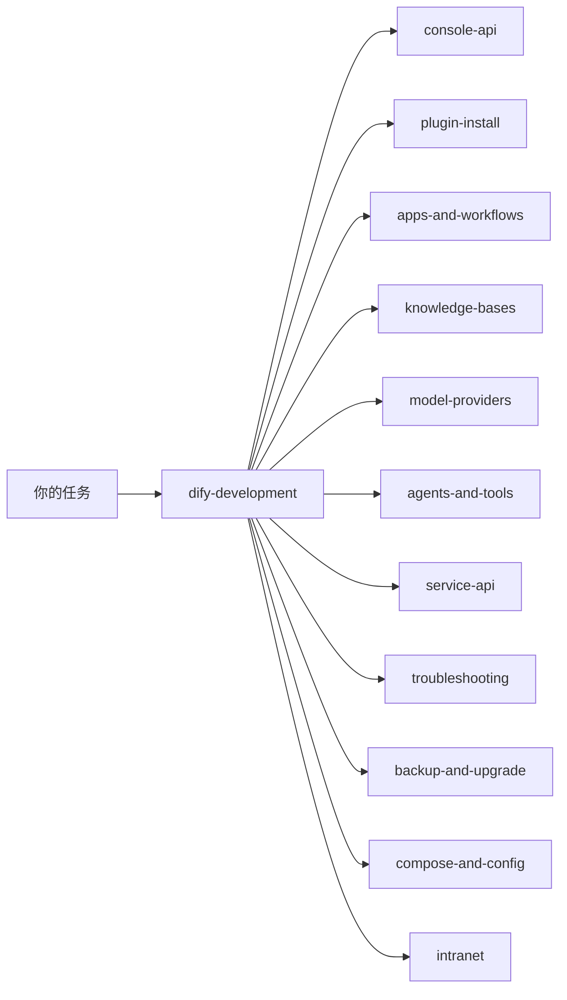
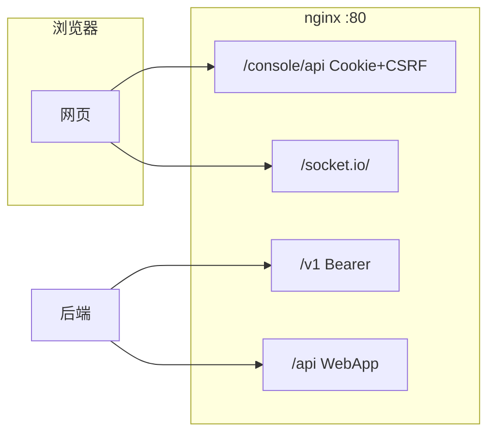

# Dify Operating Skills

[English](README.md) · 简体中文

[](https://github.com/langgenius/dify)
[](https://github.com/kabishou11/dify-skills/releases)
[](LICENSE)
[](https://agentskills.io)

维护者：[kabishou11](https://github.com/kabishou11)（Zhu Lei）

这套 [Agent Skills](https://agentskills.io)（`SKILL.md`）用来操作自托管 **[Dify](https://github.com/langgenius/dify) Community 1.17**。本树对准 **1.17.1**。内容是真实 HTTP、鉴权、payload 和失败模式。它们是给编码助手用的运维手册：助手按手册做，不要自己编路由。这**不是**控制台内[工作区 Skills](https://docs.dify.ai/en/self-host/use-dify/build/skills) 的替代品。

[`dist/`](dist/) 里的 zip 可以在 Dify 的 Skills 页 **Import** 成草稿，审阅后再发布。[`v1.17.1`](https://github.com/kabishou11/dify-skills/releases/tag/v1.17.1) 是 Dify 1.17.1 的冻结发布。`main` 继续跟踪最新的 Dify。`dify-<ver>-skills-preview` 这类预发布只提供导入用 zip，不是冻结。

官方文档：[langgenius/dify](https://github.com/langgenius/dify) · [Skills](https://docs.dify.ai/en/self-host/use-dify/build/skills)

---

## 这是什么

本仓库是给编码助手用的运维手册，不是 Dify 控制台里给 Dify Agent 用的工作区 Skills。控制台那套在 Skills 页 Import 并发布。这边是 `skills/<name>/SKILL.md`，拷进 Agent Skills 目录之后，助手按 `description` 决定是否加载。同一批目录也可以打成 zip（`SKILL.md` 在压缩包根目录）再导入控制台，让 Dify Agent 用同一份检查清单。Agent 仍然需要 HTTP 或代码工具，才能真正发出这些请求。

从 [dify-development](skills/dify-development/SKILL.md) 进入。助手只预加载 `name` 和 `description`，匹配上了才读正文。



---

## 现象对照

自托管 Dify 的故障，多半出在 URL 前缀、鉴权、compose 注入、画布 DSL，或 Service API 的 `user` 作用域。很少是因为点错了按钮。

| 现象 | 原因 | 技能 |
| --- | --- | --- |
| 登录返回 `401 Invalid encrypted data` | 密码必须是 **Base64**，不是 RSA，也不是明文 | [dify-console-api](skills/dify-console-api/SKILL.md) |
| `401 CSRF`，或大约一小时后又失败 | 有 session cookie，但没有 `X-CSRF-Token`（**GET 也要**），或者 session 已过期 | [dify-console-api](skills/dify-console-api/SKILL.md) |
| 首页返回 307 | 1.17 上，未登录访问会跳到 `/signin`。不是安装坏了 | [dify-console-api](skills/dify-console-api/SKILL.md) |
| Web SSR：“Server console API URL is not configured” | `web` 缺少 `SERVER_CONSOLE_API_URL=http://api:5001` | [dify-compose-and-config](skills/dify-compose-and-config/SKILL.md) |
| nginx 502 `host not found in upstream api_websocket` | websocket 还停着就 reload 了 nginx | [dify-troubleshooting](skills/dify-troubleshooting/SKILL.md) |
| `GET /apps` 少了一个 Agent | Agent Studio 在 `GET /agent` | [dify-console-api](skills/dify-console-api/SKILL.md) |
| 画布改了，演示跑的仍是旧图 | `/v1` 跑的是 **published** 图 | [dify-apps-and-workflows](skills/dify-apps-and-workflows/SKILL.md) |
| 文本 PDF 应用的画布上还有 OCR | 文本版和 OCR 版必须拆成两个应用 | [dify-apps-and-workflows](skills/dify-apps-and-workflows/SKILL.md) |
| 改了 `.env`，容器里看不到 | 以运行中的进程为准。官方 1.17 用 `env_file`。定制 compose 经常**显式列出** `environment:`，或 bind-mount nginx 和 squid | [dify-compose-and-config](skills/dify-compose-and-config/SKILL.md) |
| 新机器要「调到最佳」 | 调的是平台：compose、超时、上传、SSRF、worker。**不是**导入自建工具 | [dify-development](skills/dify-development/SKILL.md) 一节「新环境：Dify 平台基础配置」 |
| 长工作流在 6 分钟被杀掉 | `GUNICORN_TIMEOUT` 仍是 **360**，或 nginx 仍是 3600s | [dify-compose-and-config](skills/dify-compose-and-config/SKILL.md) |
| Celery 把 CPU 打满，模型变慢 | `CELERY_AUTO_SCALE` 没有注入 `MAX_WORKERS`，于是扩到 nproc | [dify-compose-and-config](skills/dify-compose-and-config/SKILL.md) |
| 上传 PDF 返回 413 | nginx 的 `client_max_body_size` 小于 Dify 的 `UPLOAD_*` | [dify-compose-and-config](skills/dify-compose-and-config/SKILL.md) |
| 重建 api 之后 nginx 返回 `502` | 上游 IP 被缓存。执行 `nginx -s reload` | [dify-troubleshooting](skills/dify-troubleshooting/SKILL.md) |
| 画布一直停在「同步数据中」 | 1.16 起画布走 Socket.IO `/socket.io/`。`NEXT_PUBLIC_SOCKET_URL` 必须能从浏览器访问 | [dify-troubleshooting](skills/dify-troubleshooting/SKILL.md) |
| `POST .../workflows/draft` 返回 400 `environment_variables extra_forbidden` | 1.17 的图同步不再接受顶层 env 列表 | [dify-apps-and-workflows](skills/dify-apps-and-workflows/SKILL.md) |
| React error #130 | DSL 节点缺了顶层 `type: "custom"` | [dify-apps-and-workflows](skills/dify-apps-and-workflows/SKILL.md) |
| `Invalid upload file` | `/v1` 的上传和运行必须用同一把 API key，以及同一个稳定的 `user` | [dify-service-api](skills/dify-service-api/SKILL.md) |
| 外挂知识库 404，或召回结果全被滤掉 | RAGFlow 端点必须带 `/dify`。这条路径没有 rerank，要把分数阈值关掉 | [dify-knowledge-bases](skills/dify-knowledge-bases/SKILL.md) |
| 插件 uv 以 `exit status 1` 退出 | 容器没有出网。用宿主机上的 `.difypkg`，再加本地 PEP 503 索引 | [dify-plugin-install](skills/dify-plugin-install/SKILL.md) |
| 插件列表里有名字，仍然不能用 | 以 daemon 的状态为准，并且要 **local runtime ready** | [dify-plugin-install](skills/dify-plugin-install/SKILL.md) |
| 工具返回 `Unknown error` | `tool_name` 必须是 OpenAPI 的 `operationId`，不是显示名 | [dify-agents-and-tools](skills/dify-agents-and-tools/SKILL.md) |
| 每个图都拖上 MinerU，或 OCR 结果为空 | 做成一个可复用的 workflow，再发布成工具。插件不会轮询异步的 `/file_parse` | [dify-agents-and-tools](skills/dify-agents-and-tools/SKILL.md) |
| Webhook 404，或定时任务不跑 | 公网路径是 `/triggers/webhook/{id}`。定时靠 worker_beat 的 poller | [dify-apps-and-workflows](skills/dify-apps-and-workflows/SKILL.md) |
| 在文件 `start` 上加了定时节点，发布失败 | `start` 和 Trigger 不能出现在同一张图里。解析和每日扫描要拆成两个应用 | [dify-apps-and-workflows](skills/dify-apps-and-workflows/SKILL.md) |
| `/rbac` 或 `/billing` 返回 403 | 社区版的功能开关。不是 CSRF 坏了 | [dify-development](skills/dify-development/SKILL.md) |
| 内网 HTTP 或 RAGFlow 返回 502 | Squid 的 SSRF 代理。把内网主机加进 `NO_PROXY`。`SSRF_PROXY_ALLOW_PRIVATE_IPS` 是 CIDR 列表，不是 `true` | [dify-intranet](skills/dify-intranet/SKILL.md) |
| 改了 `.env`，画布上的 Loop 上限不变 | 1.17 要 recreate **web**。运行时上限在 api 的 `WORKFLOW_MAX_*` | [dify-compose-and-config](skills/dify-compose-and-config/SKILL.md) |
| 邀请邮件发不出去 | 用 Dify 自己的 `MAIL_TYPE=smtp`，不是 email 插件 | [dify-compose-and-config](skills/dify-compose-and-config/SKILL.md) |
| 代码节点在 15 秒被杀掉 | 限制是 `SANDBOX_WORKER_TIMEOUT`，不是「sleep ≤ 2s」 | [dify-apps-and-workflows](skills/dify-apps-and-workflows/SKILL.md) |
| 知识库 hit-test 为空 | 外挂知识库要带 `/dify`。rerank 要四个字段。关掉 `score_threshold` | [dify-knowledge-bases](skills/dify-knowledge-bases/SKILL.md) |

---

## 导入到 Dify

要把检查清单放进 Dify Agent：把每个 `skills/<name>/` 打成 zip，且 **`SKILL.md` 必须在压缩包根目录**。在 Dify 1.17 的 **Skills** 页 **Import** `.zip` 或 `.skill`（默认 50 MB，`UPLOAD_SKILL_FILE_SIZE_LIMIT`）。导入结果是**草稿**。审阅后再 Publish。不要上传含密码或 `SECRET_KEY` 的本地副本。Dify Agent 仍然需要 HTTP 或代码工具，才能执行这些手册。

默认四份，在 [`dist/`](dist/)，也会作为 Release 附件：

| 包 | 适合作为检查清单的原因 |
| --- | --- |
| `dist/dify-troubleshooting.zip` | 挂了以后，先按症状分层 |
| `dist/dify-compose-and-config.zip` | compose / `.env` / nginx 旋钮 |
| `dist/dify-plugin-install.zip` | Marketplace、离线 `.difypkg`、uv |
| `dist/dify-console-api.zip` | 登录、CSRF、console 路由（给外部 curl 用的对照表） |

```bash
python3 scripts/package-dify-workspace.py          # default four → dist/*.zip
python3 scripts/package-dify-workspace.py --all
python3 scripts/package-dify-workspace.py --format skill
# manual: ( cd skills/dify-troubleshooting && zip -r ../../dist/dify-troubleshooting.zip SKILL.md )
```

---

## 安装

把 `skills/dify-*` 拷进助手会当作 [Agent Skills](https://agentskills.io) 读取的目录。要放进 **Dify 工作区**，用上面的[导入到 Dify](#导入到-dify)。不要把整个仓库拷进控制台。

```bash
git clone https://github.com/kabishou11/dify-skills.git
cd dify-skills

./scripts/install.sh user       # ~/.agents/skills
./scripts/install.sh project    # ./.agents/skills   (run from the target repo)
./scripts/install.sh --dest /your/skills/dir
```

同名的已有目录会被替换。本仓库里的文件不会被改动。

```bash
mkdir -p ~/.agents/skills
cp -R skills/dify-* ~/.agents/skills/
```

装好后试一次 `/dify-development`。如果技能没有出现，重启助手。

---

## 怎么用

1. **先分流。** 任何 Dify 任务都先走 `/dify-development`。不要让模型猜 URL。
2. **实例信息写在对话里，不要写进技能。** 例如 `DIFY=http://127.0.0.1`、管理员邮箱、compose 目录。密码、`SECRET_KEY`、API Key 只放在本地 secrets。
3. **用技能里写好的 HTTP。** 控制台是 Cookie 加 `X-CSRF-Token`（1.17 的 GET 也要带）。已发布的调用用 `Authorization: Bearer`。
4. **一次做一件事。** 登录，然后模型、插件、知识库、应用、发布、`/v1`。改完画布不等于产品可用。

```text
/dify-development
我的 Dify 在 http://127.0.0.1 ，管理员邮箱是 admin@example.com。
先登录，确认 setup 已经 finished，然后列出应用。
```

自然语言也可以。`description` 对得上就会加载。例如：内网安装插件 → plugin-install + intranet；RAGFlow 召回全是 0 → knowledge-bases；长工作流被杀掉 → compose-and-config。

---

## 技能目录

斜杠名就是目录名。

| 技能 | 覆盖范围 |
| --- | --- |
| [dify-development](skills/dify-development/SKILL.md) | 任何 Dify 工作的入口：分流、硬性规则、新机器的开工顺序，以及下一步该打开哪份技能 |
| [dify-api-catalog](skills/dify-api-catalog/SKILL.md) | 用哪个前缀、哪种鉴权：`/console/api`、`/v1`、`/api`、`/openapi/v1`、MCP inner |
| [dify-console-api](skills/dify-console-api/SKILL.md) | Base64 登录、cookie、`X-CSRF-Token`、常用 console 路由 |
| [dify-plugin-install](skills/dify-plugin-install/SKILL.md) | Marketplace 与离线 `.difypkg`、本地 PyPI、uv 失败、runtime ready |
| [dify-plugin-development](skills/dify-plugin-development/SKILL.md) | 自己编写的 tool、model、agent strategy、endpoint 插件：打包与调试 |
| [dify-apps-and-workflows](skills/dify-apps-and-workflows/SKILL.md) | 画布、DSL 0.7.0、draft 加 hash、触发器、sandbox、代码节点超时 |
| [dify-knowledge-bases](skills/dify-knowledge-bases/SKILL.md) | 切片、metadata、hit-test、外挂 RAGFlow 的 `/dify` |
| [dify-model-providers](skills/dify-model-providers/SKILL.md) | LLM、embedding、rerank、ASR，包括 OpenAI 兼容供应商 |
| [dify-agents-and-tools](skills/dify-agents-and-tools/SKILL.md) | Agent、OpenAPI `operationId`、把 workflow 发布成工具，以及三套 `tool_name` 约定 |
| [dify-workspace-extras](skills/dify-workspace-extras/SKILL.md) | 工作区 Skills、Agent Studio、日志与统计、MCP |
| [dify-service-api](skills/dify-service-api/SKILL.md) | 已发布的 `/v1`、文件对象、`user` 作用域 |
| [dify-intranet](skills/dify-intranet/SKILL.md) | `NO_PROXY`、空的 `CONSOLE_API_URL`、关闭 Marketplace，以及离线环境的 SSRF 白名单 |
| [dify-troubleshooting](skills/dify-troubleshooting/SKILL.md) | 已经坏了之后按症状排查：CSRF、uv、413、SSRF、Socket.IO |
| [dify-backup-and-upgrade](skills/dify-backup-and-upgrade/SKILL.md) | 两套 Postgres、同一把 `SECRET_KEY`、滚动升级 |
| [dify-compose-and-config](skills/dify-compose-and-config/SKILL.md) | compose、`.env` 注入、nginx 旋钮、超时、worker，以及 gunicorn 360 |

```
dify-skills/
├── skills/dify-*/SKILL.md
├── dist/                          # 导入用 zip（SKILL.md 在 zip 根目录）
├── scripts/install.sh             # user | project | --dest
├── scripts/package-dify-workspace.py
├── scripts/check-skills.py
├── VERSION
├── CHANGELOG.md
├── README.md
└── README.zh-CN.md
```

HTTP 面：



---

## 版本策略

| 位置 | 含义 |
| --- | --- |
| [`VERSION`](VERSION) | 这份树对准的 Dify 版本，以及这条线是否已经冻结 |
| `main` | 跟踪最新的 Dify，仍会变化 |
| 预发布 `dify-<ver>-skills-preview` | 导入用 zip，不是冻结 |
| Release `vX.Y.Z` | Dify `X.Y.Z` 的冻结快照。当前冻结发布是 Dify 1.17.1 的 `v1.17.1` |

版本号跟 Dify 走，不跟本仓库的 SemVer 走。一条 Dify 线冻结时才打稳定 Release，标签等于该 Dify 版本。`v1.17.1` 就是 Dify 1.17.1 的冻结发布。`main` 继续跟踪最新的 Dify。不要把 `main` 当成已经发布的契约。`dify-<ver>-skills-preview` 这类预发布是导入用 zip，不是冻结。事实对照 `api/controllers` 核对。社区版按官方环境变量配置，不把自己装成 Enterprise。

---

## 贡献

先开 [issue](https://github.com/kabishou11/dify-skills/issues)，再发 PR。1.17 的 HTTP、compose、`.env` 必须在目标机器上核对。不要猜路由。现场验证之后再泛化：密钥、内网主机名、业务 UUID 不要进 git。运行 `python3 scripts/check-skills.py`。如果改了默认会导入的那四份技能，再运行 `python3 scripts/package-dify-workspace.py`。详见 [CONTRIBUTING](CONTRIBUTING.md)。

硬性约定：不编造路由；分清 `/console/api` 和 `/v1`；密码用 Base64；插件以 **runtime ready** 为准；优先用能在内网工作的工具；不要设置 `DEPLOYMENT_EDITION=ENTERPRISE`。

---

## 安全

不要把下面任何一项写进技能、issue 或截图：管理员密码、`SECRET_KEY`、应用或数据集的 API Key、内网 IP、业务 UUID、聊天分享 token。把这些值放在部署机器的 secrets 或环境变量里。只把**变量名**告诉助手。

---

## 致谢

- **[Dify](https://github.com/langgenius/dify)** / [LangGenius](https://github.com/langgenius) — 开源 LLM 应用平台。本仓库是社区侧的操作技能，不是官方文档，也不代表 Dify 团队。
- **[Agent Skills](https://agentskills.io)** — `SKILL.md` 开放规范。
- 在真实机器上处理过 CSRF、compose 注入、Socket.IO、文件 ACL 和离线包的运维人员。

Dify 是 LangGenius 的商标。MIT 许可证：[LICENSE](LICENSE)。
